# NOC Service Delivery Troubleshooting Lab

Lab simulasi jaringan ISP end-to-end untuk melatih diagnosis gangguan pada layanan **FTTH**, **B2B**, dan **IPTV**. Dibangun dengan Containerlab dan FRRouting, lab ini mereplikasi 8 skenario gangguan yang umum dihadapi tim NOC, lengkap dengan gejala, metode diagnosis, dan bukti hasil pengujian.

---

## Ringkasan

Project ini membangun topologi ISP skala kecil yang terdiri dari jaringan inti OSPF, pelanggan B2B melalui eBGP, akses FTTH dengan PPPoE, dan distribusi IPTV berbasis multicast. Setiap skenario gangguan diinjeksikan secara terkontrol, kemudian dianalisis menggunakan alat troubleshooting standar industri untuk menemukan akar masalahnya.

## Arsitektur dan Teknologi

| Komponen | Teknologi |
| :--- | :--- |
| Orkestrasi topologi | Containerlab |
| Routing | FRRouting: OSPF (Area 0) untuk jaringan inti, eBGP untuk pelanggan B2B |
| Layanan FTTH | PPPoE dengan autentikasi CHAP (`chap-secrets` lokal pada OLT) |
| Layanan IPTV | Multicast UDP (FFmpeg sebagai headend) |
| Troubleshooting tools | `tcpdump`, `vtysh`, `ip route`, `mtr`, `iperf`, `tc netem` |

### Topologi

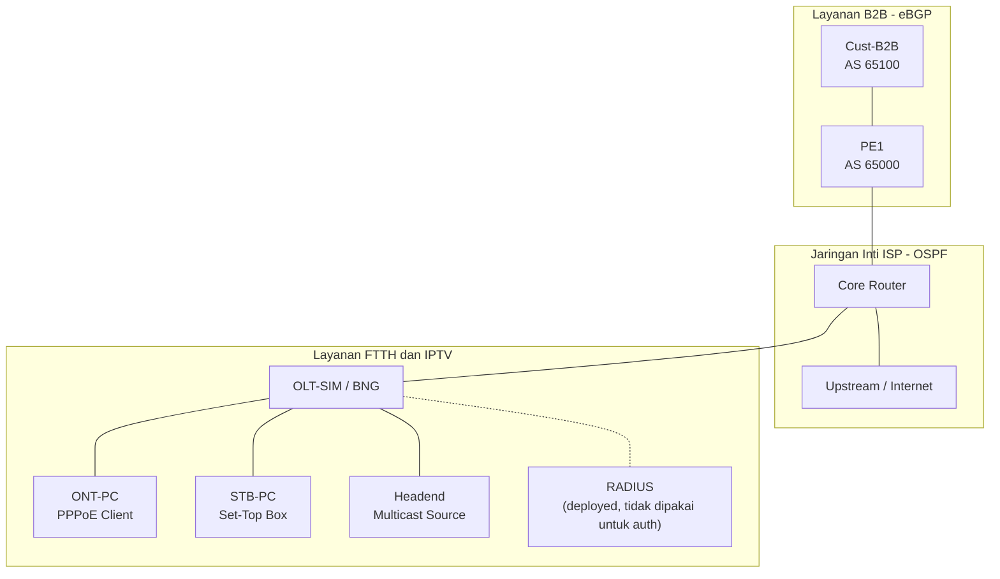

---

## Verifikasi Layanan

Sebelum gangguan diinjeksikan, ketiga layanan diverifikasi berjalan normal.

### Routing B2B: sesi eBGP Established

Pelanggan B2B menerima rute dari ISP melalui sesi eBGP yang stabil.

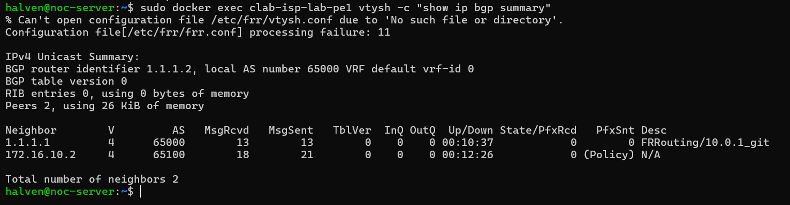

### Koneksi FTTH: sesi PPPoE aktif

Klien FTTH berhasil melakukan autentikasi PPPoE dan memperoleh alamat IP.

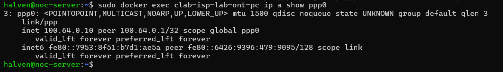

### Distribusi IPTV: multicast UDP

Headend mengirim stream multicast UDP dan diterima oleh STB pelanggan.

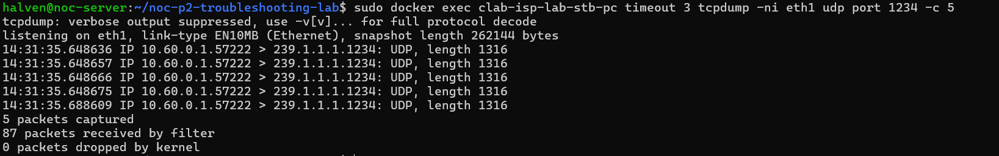

---

## Skenario Troubleshooting

| Kode | Skenario | Layanan | Akar Masalah |
| :---: | :--- | :---: | :--- |
| S1 | PPPoE authentication failed | FTTH | Kredensial CHAP tidak cocok |
| S2 | VLAN mismatch | FTTH | VLAN akses tidak sesuai di sisi OLT |
| S3 | Kegagalan DNS | FTTH | Resolver DNS tidak berfungsi |
| S4 | MTU mismatch | B2B | Ukuran MTU berbeda antar perangkat |
| S5 | BGP session down | B2B | Sesi eBGP tidak terbentuk |
| S6 | Packet loss | B2B | Loss pada link (disimulasikan `tc netem`) |
| S7 | IPTV multicast down | IPTV | Paket multicast tidak sampai ke STB |
| S8 | Interface error | B2B | Paket corrupt (disimulasikan `tc netem`) |

<details>
<summary>Tampilkan detail diagnosis S1 sampai S8</summary>

<br>

### S1: PPPoE Authentication Failed (FTTH)

- **Gejala:** pelanggan tidak mendapatkan alamat IP.
- **Diagnosis:** log `pppd` menampilkan pesan `CHAP authentication failed`.

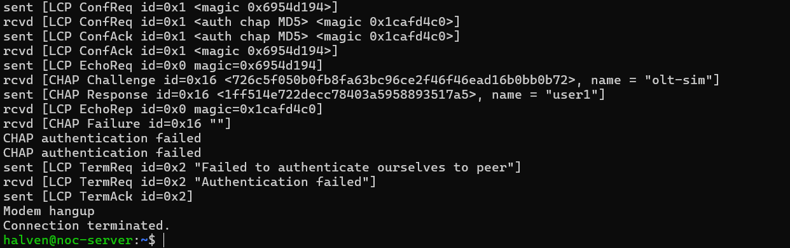

### S2: VLAN Mismatch (FTTH)

- **Gejala:** PADI terkirim tetapi tidak ada PADO.
- **Diagnosis:** `tcpdump -ni eth2 -e vlan` pada OLT menunjukkan paket VLAN 11 masuk tanpa balasan.

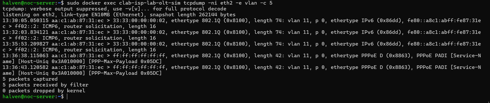

### S3: Kegagalan DNS (FTTH)

- **Gejala:** ping ke 8.8.8.8 berhasil, tetapi resolusi nama gagal.
- **Diagnosis:** `nslookup example.lab` menghasilkan NXDOMAIN atau timeout, sehingga konektivitas IP normal dan masalah terisolasi di layer DNS.

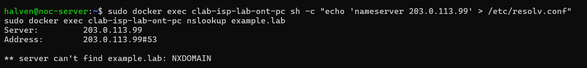

### S4: MTU Mismatch (B2B)

- **Gejala:** ping paket kecil berhasil, ping paket besar gagal.
- **Diagnosis:** `ping -M do -s 1472` mengembalikan error `Frag needed`, yang menandakan MTU di sepanjang jalur tidak seragam.

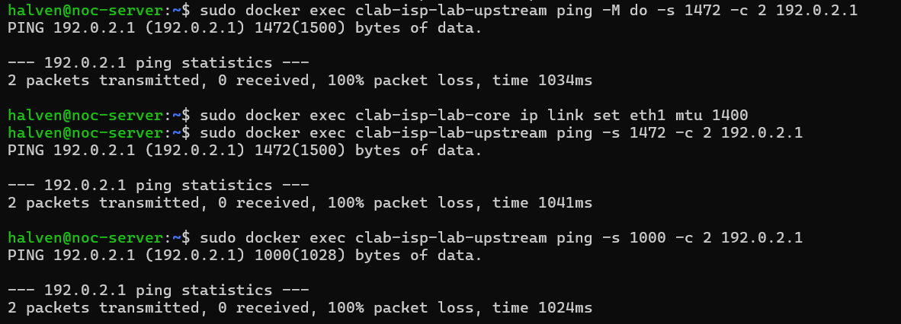

### S5: BGP Session Down (B2B)

- **Gejala:** rute internet pada sisi pelanggan hilang.
- **Diagnosis:** `show ip bgp summary` menampilkan state `Active` atau `Idle`.

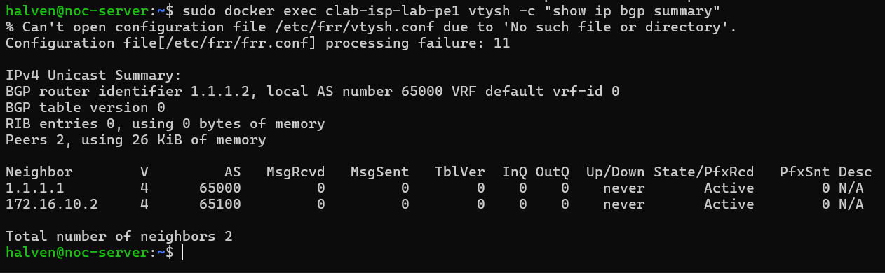

### S6: Packet Loss (B2B)

- **Gejala:** koneksi lambat dengan loss tinggi.
- **Diagnosis:** `ping` dan `mtr` menunjukkan packet loss sekitar 10% akibat `tc netem` pada link.


### S7: IPTV Multicast Down

- **Gejala:** layar TV biru tanpa siaran.
- **Diagnosis:** `tcpdump` pada headend menunjukkan paket UDP keluar, sedangkan pada STB tidak ada paket yang diterima. Gangguan berada di jalur distribusi antara headend dan STB.

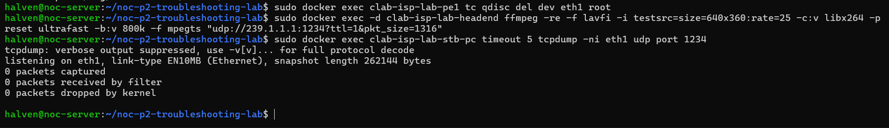

### S8: Interface Error (B2B)

- **Gejala:** throughput turun dan paket mengalami corrupt.
- **Diagnosis:** `tc netem corrupt 10%` menyebabkan loss parah, terlihat pada hasil uji `iperf` dan statistik error interface.

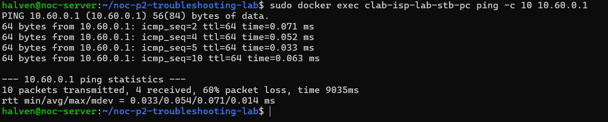

</details>

---

## Menjalankan Lab

### Prasyarat

- Linux dengan Docker terpasang
- [Containerlab](https://containerlab.dev/install/)

### Perintah

```bash
# Deploy topologi
sudo containerlab deploy -t topology.clab.yml

# Cek status node
sudo containerlab inspect -t topology.clab.yml

# Hapus lab setelah selesai
sudo containerlab destroy -t topology.clab.yml
```

## Struktur Repository

```text
.
├── configs/              Konfigurasi perangkat
├── images/client/        Definisi image untuk node klien
├── screenshots/          Bukti hasil pengujian
├── topology.clab.yml     Definisi topologi Containerlab
└── README.md
```

## Batasan Simulasi

- Lab berjalan di atas container Docker, sehingga tidak melibatkan perangkat fisik OLT maupun ONT.
- IGMP snooping disimulasikan dengan bridge L2 (`br0`) untuk menyederhanakan pengujian multicast.
- Container RADIUS ikut di-deploy pada topologi, tetapi autentikasi PPPoE dialihkan ke `chap-secrets` lokal pada OLT karena image FreeRADIUS tidak stabil di lingkungan Docker lab ini. Integrasi RADIUS penuh menjadi pengembangan lanjutan.

## Penulis

**Ridho K. Satrio**
GitHub: [@ridhoksatrio](https://github.com/ridhoksatrio)
